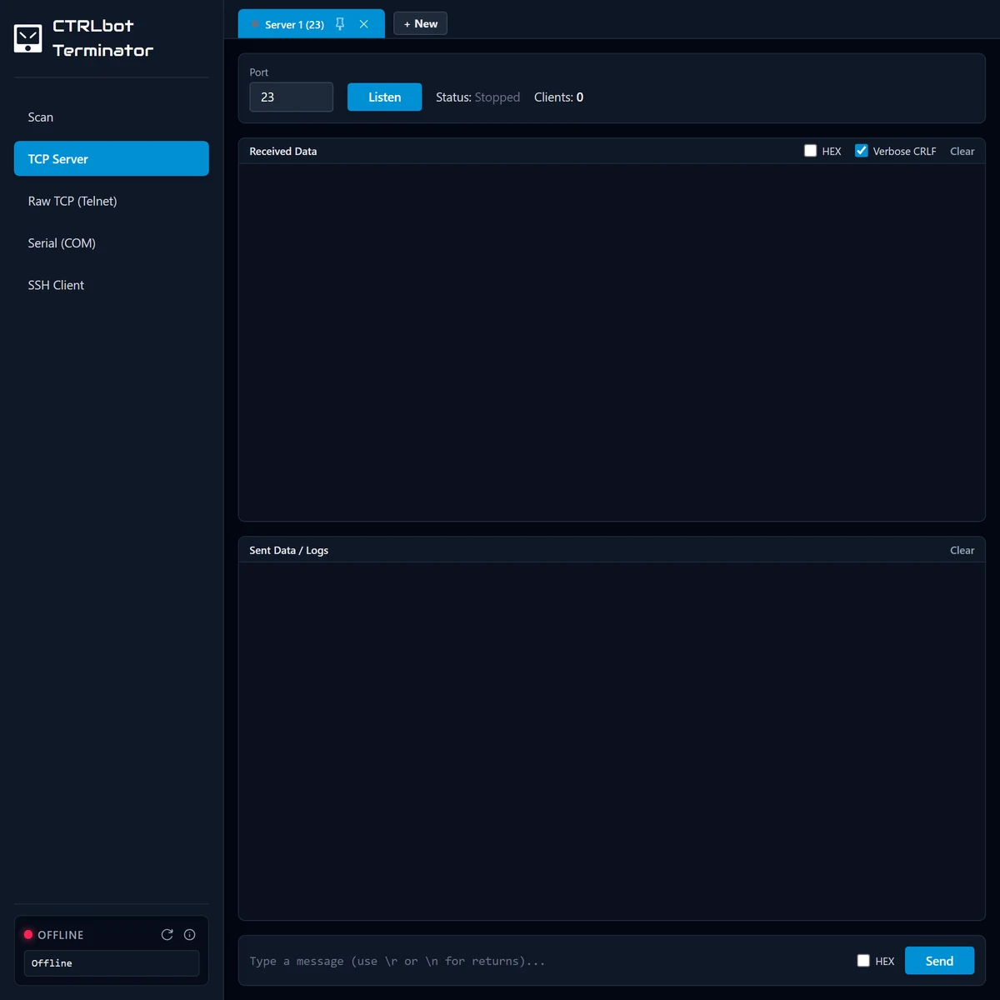

# CTRLbot Terminator

CTRLbot Terminator is a Windows tool for testing IP and serial devices. Open TCP, serial and SSH sessions, or use Scan to find devices on the selected local network.



## Download

Get the Windows x64 installer or portable executable from [Releases](https://github.com/ctrlbotty/ctrlbot-term/releases/latest). The installer adds shortcuts and an uninstaller. The portable build needs the Microsoft Edge WebView2 Runtime. Release v1.0.0 is unsigned, so Windows may show a SmartScreen prompt.

## Tools

| Tab | What you can do |
| --- | --- |
| TCP Server | Listen on a local port, see connected clients and broadcast messages. |
| TCP Client | Connect to a raw TCP or Telnet endpoint and choose an outbound line ending for text. |
| Serial | Select a COM port, baud rate, data bits, parity and flow control. |
| SSH | Open an interactive shell on a device. |
| Network Status | Inspect local adapters and their network settings. |
| Scan | Discover devices on the IPv4 subnet of a selected adapter. |

TCP and Serial tabs send text or hexadecimal bytes. Enter complete byte pairs such as `01 A0 FF`. Use **HEX** to view received bytes, or show `<CR>` and `<LF>` in the text log with **Verbose CRLF**.

Scan supports `/16` through `/32`. It uses ARP with ping and TCP fallbacks. Host and device names come from available discovery evidence such as mDNS, SSDP, NetBIOS and Windows name resolution. Hover over a value to see its source. MAC vendor lookup uses the bundled IEEE registry offline. You can filter by name, manufacturer, IP or MAC. Stopping a scan retains the results gathered so far.

## Build from source

Install Node.js 22.12 or newer, Rust with Cargo, and the Visual Studio C++ Build Tools. From the repository root:

```powershell
npm ci
npm run tauri dev
```

Run the frontend build and byte-formatting tests, then the native tests:

```powershell
npm test
npm run build
cargo test --manifest-path src-tauri/Cargo.toml --locked
```

`npm run bundle` builds the NSIS installer and portable executable under `installers/`. See the generated `installers/README.txt` for package names and requirements. To refresh the offline MAC vendor table, see [the registry maintenance instructions](src-tauri/data/README.md).

## License

Terminator is licensed under the [MIT License](LICENSE). Third-party software and data are listed in [NOTICE](NOTICE).
